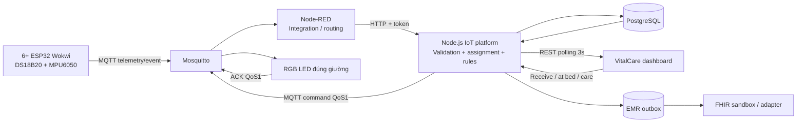

# Thiết kế triển khai và đối chiếu IIAF

## Phạm vi và quyết định

Nguyên mẫu học phần dùng bệnh nhân giả lập. Mặc định 6 giường; `DEVICE_COUNT=20` tạo một khoa 20 giường. Mỗi giường có một ESP32 cố định, DS18B20, MPU6050, RGB LED và nút gọi. Mạch, SpO₂, nhịp thở, huyết áp và cân nặng là dữ liệu sinh bởi firmware. Biến trở chỉ điều khiển kịch bản SpO₂ thấp, không được gọi là máy đo SpO₂.

Hai chế độ dùng cùng domain service, payload và dashboard:

Chế độ nhanh thay Mosquitto bằng Aedes trong tiến trình, Node-RED bằng subscriber MQTT trực tiếp, PostgreSQL bằng SQLite WAL và Wokwi bằng 6 MQTT simulator riêng. Đây là **6 thiết bị logic giả lập bằng phần mềm**, không khẳng định 6 phiên Wokwi đang chạy. `npm run simulate` là simulator cho Docker; không chạy song song với Wokwi cho cùng ID.

| Tầng theo đề bài | Thành phần đã viết | Trách nhiệm |
|---|---|---|
| Device | `firmware/dev-hp01` … `dev-hp06` | Đọc 2 sensor, tạo kênh giả lập, nút gọi, đèn + ACK |
| Communication | MQTT 3.1.1 / Mosquitto | Topic định danh, tài khoản/ACL từng thiết bị |
| Platform | Node-RED + `server/mqtt.js`, `server/index.js` | Tích hợp giao thức, quản lý thiết bị, API |
| Data | `server/db.js`, PostgreSQL / SQLite | Schema, chỉ mục, trạng thái bền vững, transaction |
| Processing | `server/service.js` | Validation, mapping theo thời gian, sustain/recovery, workflow |
| Application | `public/` | Dashboard tiếng Việt, đồ thị SVG, phiếu in, CSV |
| Action | Command outbox + RGB LED | ID, expiry, assignment, retry, ACK kiểm tra chéo |
| Integration | EMR outbox + FHIR transaction Bundle | Xác nhận, retry độc lập, PUT idempotent |

Dashboard tùy chỉnh thay FlowFuse để bám phiếu chức năng sống. Node-RED đảm nhiệm tích hợp; rule và nghiệp vụ nằm ở backend để kiểm thử và giao dịch nguyên tử. Đây là điều chỉnh so với công nghệ đề xuất trong tài liệu, không khẳng định toàn bộ rule nằm trong Flow. Nhóm vẫn cần bổ sung minh chứng ít nhất hai technology component đã nghiên cứu trong bài tập nhóm trước.

## Bốn góc nhìn IIAF

- **Nghiệp vụ:** xác định đúng bệnh nhân cần hỗ trợ, theo dõi người phụ trách và thời gian đáp ứng.
- **Sử dụng:** theo dõi → vượt ngưỡng/gọi hỗ trợ → điều dưỡng nhận → đến giường → xử lý → hoàn tất → xác nhận gửi hồ sơ.
- **Chức năng:** ingestion, định danh, data quality, storage, rule, workflow, control, visualization, integration.
- **Triển khai:** ESP32 mô phỏng, MQTT broker, Node-RED, API, DB và trình duyệt; cấu hình local và Docker được tách rõ.

## Định danh và thời gian

Không dùng giường làm mã bệnh nhân. Bản tin chứa patient_id, encounter_id, assignment_id, device_id, bed_id và ward_id. Máy chủ đối chiếu cả sáu với `assignments`, theo khoảng `[started_at, ended_at)` và không trước thời điểm nhập viện. Khi đổi giường, phần cứng ở lại giường, hai bệnh nhân/lượt điều trị được hoán đổi, hai assignment mới được phát bằng config MQTT retained. Mẫu trước thời điểm đổi đến trễ vẫn lưu cho bệnh nhân cũ, không đánh giá rule trực tiếp hoặc ghi đè latest. Việc chăm sóc trước chuyển giường giữ giường phát sinh trong lịch sử; danh sách xử lý đồng thời hiển thị giường hiện tại để nhân viên đến đúng vị trí.

`measured_at` bắt buộc ISO8601 có múi giờ; `received_at` do server bổ sung. Mẫu quá 5 giây trong tương lai bị từ chối; tuổi mẫu live theo `maxLiveAgeSeconds`. Chỉ mẫu mới hơn latest mới thay đổi trạng thái sinh tồn. Chống trùng bằng message_id; dùng lại ID cho nội dung khác trả 409.

## Quy tắc demo và workflow

| Rule | Điều kiện mặc định | Action |
|---|---|---|
| spo2_low | SpO₂ <92% trong ≥5 giây | Cảnh báo cao, tạo việc, đèn đỏ nhấp nháy |
| pulse_abnormal | Mạch <50 hoặc >120 trong ≥5 giây | Cảnh báo cao, tạo việc, đèn đỏ |
| temperature_high | Nhiệt độ >38.5°C trong ≥5 giây | Cảnh báo, tạo việc, đèn đỏ |
| nurse_call | Sự kiện nút gọi | Tạo việc, đèn xanh dương |
| offline | Không có mẫu mới >15 giây | Cảnh báo kỹ thuật, yêu cầu kiểm tra, đèn vàng nếu thiết bị còn nhận lệnh |
| escalation | Chưa nhận/chưa đến giường >60 giây | Đổi người phụ trách sang điều dưỡng trưởng, ghi event |
| recovery | Mẫu hợp lệ trở lại trong ≥5 giây | Kết thúc điều kiện, giữ công việc mở |

Mỗi đợt lưu evidence (giá trị, nguồn, thời gian và phiên bản rule). Nhiễu/invalid cắt thời gian duy trì và không được dùng xác nhận hồi phục. Khoảng gián đoạn quá offlineSeconds đặt lại bộ đếm. Chất lượng nhiễu hiển thị `—`, không dùng mẫu cũ điền mới. Ngưỡng này chỉ phục vụ test kỹ thuật.

`assigned → accepted → at_bed → in_progress → completed`. API không cho bỏ bước. Hoàn tất cần ghi chú ≥5 ký tự và điều kiện đã kết thúc; riêng nurse_call được kết thúc cùng công việc. Hoàn tất tạo care_record. Actor lấy từ session, không lấy từ payload người dùng. Mọi điều dưỡng trong ca có thể tiếp nhận thay đồng nghiệp và thao tác được ghi lịch sử; chưa có kiểm soát ca trực thực tế.

Đèn ưu tiên sinh tồn đỏ > kỹ thuật vàng > gọi xanh. Tiếp nhận chuyển đỏ nhấp nháy sang đỏ liên tục nhưng không xóa điều kiện. Lệnh chứa command_id, assignment_id, device_id, bed_id, issued_at, expires_at. Backend gửi lại QoS1 khi chưa ACK, không retain lệnh. Lệnh hết hạn được thay mới; firmware từ chối assignment sai và lệnh hết hạn. ACK khác mode/device/assignment bị từ chối. ACK ở đây xác nhận firmware áp chân GPIO, chưa có sensor độc lập xác nhận đèn vật lý sáng.

## Lưu trữ, truy vấn, hồ sơ

Schema SQL được tạo idempotent trong `server/db.js`: patients, encounters, beds, devices, assignments, messages, measurements, alarms, requests, request_events, care_records, commands, rule_state, settings, emr_outbox, emr_records, audit_logs. Partial unique indexes bảo đảm chỉ một assignment đang mở trên mỗi thiết bị/giường/bệnh nhân và một đợt mở trên mỗi rule/assignment.

Domain mutations chạy tuần tự, trong transaction. Hàng đợi DB cách ly các reader ngoài giao dịch; snapshot nhiều bảng được đọc trong cùng transaction, tránh thấy nửa trạng thái đổi giường. Cấu hình PostgreSQL hiện dùng một connection để giữ semantics này. Khi scale thật cần khóa theo device/assignment, hàng đợi và connection pool phù hợp. History query có chỉ mục patient/time, dùng window function lấy mẫu ngay trong SQL trước khi tải payload; tối đa 2.000 mẫu và khoảng truy vấn tối đa 31 ngày. Chưa làm min/max-preserving downsampling: mẫu cực trị ngắn có thể không nằm trong bộ mẫu giảm; bản gốc vẫn có trong DB.

EMR chỉ gửi sau xác nhận. Observation có subject, encounter, effectiveDateTime, device, LOINC, UCUM; huyết áp dùng Observation 85354-9 với 2 component. Care record gửi dạng Communication đã hoàn tất. Sandbox chỉ là adapter demo, không phải máy chủ FHIR đầy đủ hoặc hệ thống HIS thật. Nếu HIS dùng API khác cần thay adapter và thỏa thuận mapping. Chưa đồng bộ danh mục nhập/xuất khoa từ HIS thật; seed và API đổi giường mô phỏng phần này.

Không tự xóa dữ liệu đang demo. Định hướng lưu chi tiết 30 ngày cần được cấu hình bằng một job vận hành có backup và chính sách đã thống nhất; chưa bật purge để tránh mất minh chứng. Sao lưu SQLite khi server dừng bằng cách copy `data/health.db`; PostgreSQL dùng `pg_dump`. Lưu riêng `.env`; không đưa vào git.

## Giới hạn đã công bố

- Không phải sản phẩm y tế đã thẩm định; không chẩn đoán hoặc điều trị tự động.
- Không có ECG thật: biểu đồ là xu hướng pulse_rate theo thời gian. Không vẽ sóng điện tim giả để tạo cảm giác đang đo ECG.
- Mặc định localhost, HTTP/MQTT chưa TLS. Dùng reverse proxy TLS và MQTT TLS, quản lý credential tập trung trước khi truy cập từ mạng ngoài.
- Tài khoản nurse/admin là tài khoản demo, chưa tích hợp SSO hoặc quản lý nhân sự. UI có cảnh báo bộ credential demo.
- Node-RED HTTP forwarding không có persistent transport queue; khi API dừng có thể mất telemetry/event trên đường này. MQTT QoS1 xác nhận tới subscriber không bảo đảm đã commit DB. Offline alert và thử lại command/EMR được bảo đảm ở domain sau khi ghi DB; cần thêm ingestion queue bền vững cho vận hành thật.
- Firmware không lưu telemetry/nurse_call xuống flash để store-and-forward khi mất mạng; chưa xác nhận chạy đồng thời sáu Wokwi trong phiên triển khai nếu chưa có minh chứng test.

## Nguồn tham chiếu

- Hai PDF yêu cầu và phân tích giải pháp do người dùng cung cấp; ảnh phiếu chức năng sống.
- [Wokwi DS18B20](https://docs.wokwi.com/parts/wokwi-ds18b20), [MPU6050](https://docs.wokwi.com/parts/wokwi-mpu6050).
- [Wokwi Wi-Fi và Private Gateway](https://docs.wokwi.com/guides/esp32-wifi), [wokwi.toml](https://docs.wokwi.com/vscode/project-config).
- [HL7 FHIR R4 Vital Signs](https://hl7.org/fhir/R4/observation-vitalsigns.html).
