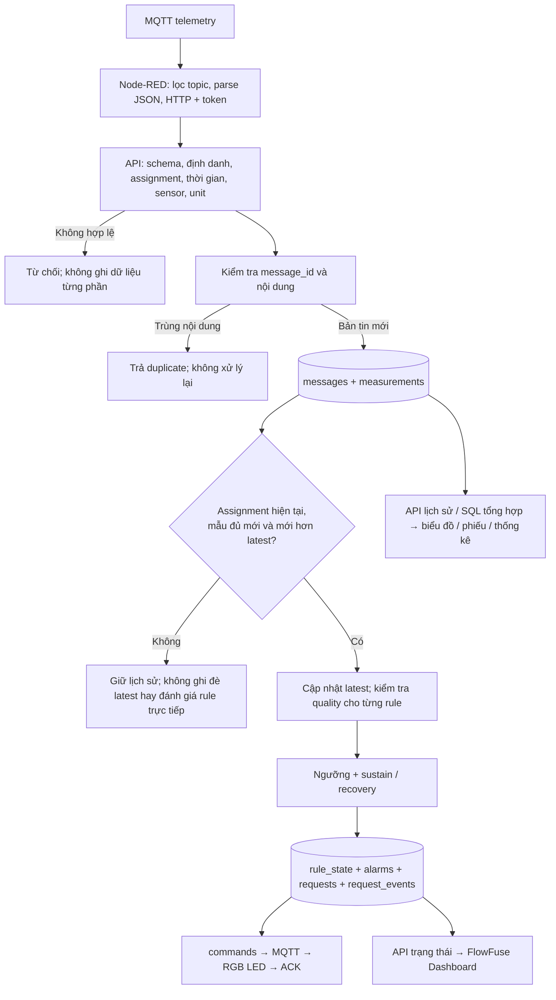

# Kiểm chứng Data Processing và Analytics

Ngày kiểm chứng: 19/10/2026 (Asia/Saigon). Đối chiếu yêu cầu trong ảnh: hệ thống phải có ít nhất một cơ chế xử lý dữ liệu; danh sách cơ chế là các lựa chọn, không phải bắt buộc triển khai tất cả.

## Kết luận

Project đáp ứng yêu cầu bằng các cơ chế chạy trong ứng dụng: kiểm tra/lọc dữ liệu, chuyển đổi dữ liệu, xử lý từng bản tin có trạng thái và phát hiện bất thường dựa trên quy tắc. Có tổng hợp số lượng trên Dashboard và truy vấn SQL tổng hợp/thống kê mô tả theo thời gian. Chưa có ML/AI; SQL trung bình theo phút hiện là công cụ phân tích thủ công, không phải pipeline tính trung bình tự động của biểu đồ FlowFuse.

## 1. Bản đồ yêu cầu tới mã nguồn

| Cơ chế | Trạng thái | Vị trí và biểu hiện |
|---|---|---|
| Filtering | Đã tích hợp | `server/service.js:143` kiểm tra assignment/thời gian; `:174` schema/topic/readings; `:213` chống trùng; `:279` lọc dữ liệu đủ mới; `:305` kiểm tra quality trước rule. |
| Transformation | Đã tích hợp | `server/service.js:255` lưu bản tin, `:265` tách readings thành measurements; `:734` biến đổi phép đo sang FHIR Bundle. Node-RED parse chuỗi JSON và đóng gói HTTP. |
| Rule-based processing | Đã tích hợp | `server/service.js:295` so sánh SpO₂/mạch/nhiệt độ, `:320` sustain, `:329` recovery, `:333` lưu rule_state, `:343` tạo alarm/request, `:580` offline/escalation. |
| Anomaly detection | Đã tích hợp ở mức quy tắc | Bất thường vượt ngưỡng và mất mẫu, không phải thuật toán ML hoặc phát hiện ngoại lệ thống kê. |
| Stream processing | Đã tích hợp ở mức ứng dụng | Mỗi telemetry tới API được xử lý ngay trong domain service, có trạng thái theo assignment/rule, trong hàng đợi và transaction. Không có Kafka/Flink hay cam kết exactly-once toàn tuyến. |
| Aggregation | Có ở hai phạm vi | `infra/node-red/dashboard/component.vue:47` đếm giường/online/alarm/công việc; câu 05/06/07/09 trong `docs/sql/postgres-exploration.sql` GROUP BY thời gian/thiết bị/chất lượng/trạng thái. |
| Statistical analysis | Thống kê mô tả qua SQL | AVG, MIN, COUNT trong bộ SQL; truy vấn kiểm chứng dưới đây bổ sung MAX. Chưa có phân tích dự báo hoặc mô hình thống kê tự động. |
| Machine learning / AI | Chưa triển khai | Không có model huấn luyện/inference; không cần thêm để đáp ứng yêu cầu tối thiểu này. |

## 2. Pipeline thật đang thực hiện



Hình mô tả luồng logic; lưu dữ liệu và thay đổi nghiệp vụ liên quan được thực hiện trong transaction. Bản tin cùng ID nhưng khác nội dung bị từ chối với lỗi xung đột, không phải duplicate hợp lệ.

## 3. Filtering: có nhiều lớp khác nhau

1. **Lọc đầu vào:** topic phải khớp payload; đủ định danh; có đúng tám mã readings không trùng; sensor ID/type/unit/range/quality/source phải đúng quy định.
2. **Lọc theo assignment/thời gian:** thời điểm đo thuộc khoảng gán bệnh nhân, không trước nhập viện và không quá xa trong tương lai. Bệnh nhân đổi giường không khiến mẫu cũ bị chuyển sang bệnh nhân khác.
3. **Chống trùng:** một message_id với cùng nội dung không được ghi và đánh giá lại.
4. **Lọc luồng live:** mẫu hợp lệ nhưng cũ/đến sai thứ tự vẫn có thể được lưu lịch sử; không ghi đè mẫu mới hoặc tạo cảnh báo sinh lý mới từ mẫu đó.
5. **Lọc chất lượng:** chỉ readings quality valid được dùng đánh giá rule tương ứng. Suspect/invalid cắt bộ đếm duy trì/hồi phục và không tự xóa alarm đã có. Các reading này vẫn được giữ để truy vết.
6. **Lọc hiển thị:** `infra/node-red/dashboard/visuals.js:48` chỉ vẽ reading valid; ngắt đường ở khoảng mất dữ liệu hoặc chất lượng không hợp lệ.

Đây là kiểm soát chất lượng và lựa chọn dữ liệu, không phải bộ lọc tín hiệu số như Kalman hoặc low-pass; project chưa triển khai các bộ lọc đó.

## 4. Rule-based processing và phát hiện bất thường

Cấu hình đọc trực tiếp từ PostgreSQL trong lượt kiểm chứng:

| Tham số | Giá trị |
|---|---:|
| spo2Low | 92 |
| pulseLow / pulseHigh | 50 / 120 |
| temperatureHigh | 38,5°C |
| sustainSeconds / recoverySeconds | 5 / 5 giây |
| offlineSeconds / maxLiveAgeSeconds | 60 / 60 giây |
| escalationSeconds | 60 giây |
| version | 3 |

Các giá trị có thể đổi qua Quản trị; đây là tham số demo, không phải ngưỡng được thẩm định lâm sàng.

Ví dụ với mẫu mới, đúng assignment và quality valid:

| Thời điểm đo tương đối | SpO₂ | Kết quả |
|---|---:|---|
| t = 0 s | 87% | Bắt đầu ghi since_at, chưa đủ 5 giây |
| t = 3 s | 88% | Điều kiện còn duy trì, chưa đủ 5 giây |
| t = 5 s | 87% | Tạo spo2_low nếu chưa có đợt active |
| t = 6 s | 87% | Không tạo thêm một alarm trùng cho cùng rule/assignment |
| t = 7 s | 97% | Bắt đầu recovery_at |
| t = 12 s | 97% | Nếu các mẫu giữa đó hợp lệ, bình thường, không có khoảng gián đoạn vượt ngưỡng: kết thúc alarm |

Timeline là ví dụ giải thích logic, không phải log Wokwi mới được ghi trong lượt này. Công việc chăm sóc vẫn cần hoàn tất bằng workflow sau khi alarm cleared.

Đầu ra xử lý được lưu ở rule_state, alarms (có evidence và cấu hình rule), requests, request_events và commands. Vì có dữ liệu suy diễn và hành động dựa trên dữ liệu đầu vào, đây không chỉ là lưu trữ và hiển thị.

## 5. Transformation và tổng hợp/thống kê

- Chuỗi MQTT JSON được Node-RED parse thành object và đóng gói `{topic, payload}` cho HTTP ingestion.
- Một telemetry được tách thành một dòng messages và tám dòng measurements; không sửa giá trị sensor để làm đẹp biểu đồ.
- `confirmEmr()` ánh xạ readings sang FHIR Observation, mã LOINC và đơn vị UCUM; huyết áp được ghép thành Observation có hai component. Đây là chuyển đổi cấu trúc và ánh xạ ngữ nghĩa, không khẳng định có bộ đổi mọi đơn vị đầu vào.
- API lịch sử dùng `ROW_NUMBER()`/`COUNT()` để lấy tập mẫu có giới hạn trải theo khoảng truy vấn. Đó là giảm số mẫu, không phải lấy trung bình theo phút và chưa bảo đảm giữ mọi cực trị ngắn.
- SQL tổng hợp theo phút có sẵn trong tài liệu thực hành, người dùng chạy bằng pgAdmin/psql. Biểu đồ FlowFuse hiện dùng các mẫu lịch sử API trả về.

Truy vấn dưới đây đã chạy thành công trên PostgreSQL đang hoạt động, chỉ đọc dữ liệu:

```sql
SELECT
  date_trunc('minute', measured_at::timestamptz)
    AT TIME ZONE 'Asia/Ho_Chi_Minh' AS minute_vn,
  count(*) AS sample_count,
  round(avg(value)::numeric, 2) AS spo2_avg,
  min(value) AS spo2_min,
  max(value) AS spo2_max
FROM measurements
WHERE patient_id = 'BN-001'
  AND code = 'spo2'
  AND quality = 'valid'
  AND measured_at::timestamptz BETWEEN now() - interval '1 hour' AND now()
GROUP BY 1
ORDER BY 1 DESC
LIMIT 5;
```

Ví dụ kết quả thực tại phút **21:54 ngày 19/10/2026, giờ Việt Nam**: 60 mẫu, trung bình 97,09%, nhỏ nhất 96%, lớn nhất 98%. Phút đang diễn ra có thể chưa đủ mẫu. Trung bình có thể che một bất thường ngắn, vì vậy rule engine đánh giá mẫu đầu vào đủ điều kiện, không chờ kết quả trung bình phút.

## 6. Kiểm chứng đã thực hiện

### Kiểm thử tự động

Chạy ba file `tests/system.test.js`, `tests/mqtt.test.js`, `tests/flowfuse.test.js` bằng Node bundled runtime. **28/28 PASS, 0 FAIL**. Log lưu tại [data-processing-test.log](data-processing-test.log).

Các kết quả trực tiếp liên quan:

| Kiểm thử | Điều được kiểm chứng |
|---|---|
| Malformed payloads / T13 | Payload sai bị từ chối, chống trùng/xung đột, không ghi DB từng phần |
| T02/T03 | Bất thường duy trì tạo hai loại alarm trong kịch bản hypoxia; không tạo lặp đợt; có command và ACK |
| T14 | Mẫu suspect không xóa cảnh báo sinh lý đã có; không được xác nhận gửi EMR |
| Old and out-of-order measurements | Mẫu cũ lưu được nhưng không ghi đè latest |
| Delayed telemetry | Mẫu trễ được nhận diện stale, không tạo alarm sinh lý mới; phân biệt với offline |
| History SQL | Truy vấn lịch sử giới hạn đúng số mẫu, loại event, limit=1 lấy mẫu đo mới nhất |
| Workflow / offline / escalation | Có kiểm soát trạng thái và xử lý sự cố theo quy tắc |
| T11 | Chuyển đổi hồ sơ, huyết áp hai component, xác nhận idempotent và retry khi EMR lỗi |

Phạm vi: bộ test dùng database SQLite cô lập; bài kiểm tra MQTT dùng Aedes và sáu publisher phần mềm. Đây là kiểm thử logic ứng dụng/giao thức, không thay cho kiểm thử đầy đủ Wokwi → Mosquitto → Node-RED → PostgreSQL trong lượt này. Tên test T14 có đề cập sustain, nhưng assertions trực tiếp của test chủ yếu chứng minh suspect không clear alarm và không được gửi EMR; cơ chế reset sustain được kiểm tra ở mã nguồn.

### PostgreSQL đang hoạt động

- Đã đọc cấu hình rule version 3.
- Tại snapshot đầu: 17.586 messages; mỗi mã chỉ số có 17.581 measurements. Chênh lệch phù hợp việc messages có cả event không chứa readings; không dùng count messages để suy ra số telemetry khi chưa lọc.
- Đã chạy AVG/MIN/MAX/COUNT theo phút thành công.
- Lịch sử alarms có các rule spo2_low, pulse_abnormal, temperature_high, offline, nurse_call. Dữ liệu lịch sử không đồng nghĩa tất cả tình huống vừa được tạo trong lượt kiểm chứng này.
- Simulator Docker đang chạy tại lúc kiểm tra; lịch sử có source wokwi và simulated. Không mặc định gọi dữ liệu hiện tại là từ Wokwi; các kênh mạch/SpO₂ do firmware Wokwi tạo cũng có source simulated nên cần xem DS18B20/MPU6050 và nguồn chạy để phân biệt.

Không thay đổi ngưỡng, trạng thái chăm sóc, dữ liệu bệnh nhân hoặc bật/tắt nguồn phát trong lượt kiểm chứng này.

## 7. Minh chứng nên trình bày khi báo cáo

1. Chỉ `ingest()` để giải thích lọc/schema/dedup/freshness/quality.
2. Chỉ đoạn threshold + since_at/recovery_at và các bảng rule_state/alarms/requests.
3. Demo biến trở cao → SpO₂ thấp và mạch cao → alarm → đèn → ACK; khôi phục để chứng minh recovery, không chỉ một phép so sánh ngưỡng.
4. Dùng một trường hợp mẫu trễ hoặc suspect để giải thích vì sao vẫn lưu nhưng không dùng như dữ liệu live hợp lệ.
5. Chạy SQL trên để minh chứng tổng hợp/thống kê, nêu rõ thao tác phân tích này hiện chạy thủ công.
6. Mở log 28 tests và nói đúng phạm vi của từng lớp kiểm tra.

Đoạn trả lời đề xuất: “Project đáp ứng yêu cầu xử lý dữ liệu bằng cơ chế dựa trên quy tắc có trạng thái. Mỗi bản tin được kiểm tra định danh, cấu trúc, chống trùng và độ mới; các phép đo hợp lệ được đánh giá theo ngưỡng cùng thời gian duy trì/hồi phục để tạo cảnh báo và công việc. Hệ thống còn biến đổi payload thành dữ liệu quan hệ và FHIR. SQL hỗ trợ tổng hợp/thống kê mô tả theo phút; phần này chưa được tự động hóa thành pipeline phân tích trên Dashboard. Project chưa triển khai ML/AI.”
