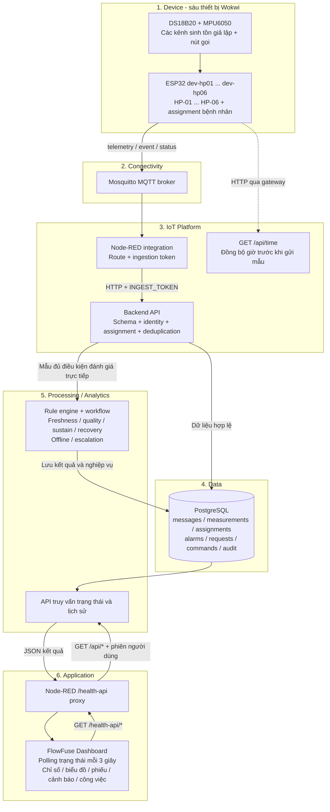
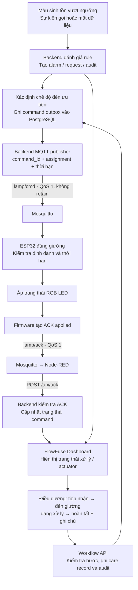
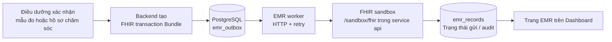

# Kiến trúc IIAF và luồng xử lý Smart Health

Đối chiếu mã nguồn ngày 11/10/2026. Tài liệu áp dụng cho chế độ Docker Compose + Wokwi + FlowFuse Dashboard; các tầng IIAF được trình bày theo yêu cầu của học phần trong ảnh. Đây là phân chia trách nhiệm logic, không yêu cầu mỗi tầng là một container riêng.

## 1. Chuỗi kiến trúc theo đề bài

**Device → Connectivity → Platform → Data → Processing/Analytics → Application → Decision/Action.**

Trong project: **ESP32 Wokwi → MQTT/Mosquitto → Node-RED + API → PostgreSQL → Rule engine và truy vấn lịch sử → FlowFuse Dashboard → Điều dưỡng xử lý và ESP32 điều khiển RGB LED.**

Decision/Action có hai nhánh: quy tắc tự động phát lệnh đèn ngay khi phát hiện điều kiện; điều dưỡng xem dashboard rồi thực hiện quy trình chăm sóc. Vì vậy, không phải mọi lệnh tự động đều phải chờ người dùng thao tác trên giao diện.

| Tầng | Thành phần hiện có | Trách nhiệm và đầu ra |
|---|---|---|
| Device | Sáu project `firmware/dev-hp01` đến `firmware/dev-hp06`; ESP32, DS18B20, MPU6050, nút gọi, RGB LED | Mỗi thiết bị gắn một giường và một assignment bệnh nhân đang hiệu lực; tạo telemetry, sự kiện gọi; nhận lệnh đèn và trả ACK. |
| Connectivity / Communication | Wi-Fi Wokwi-GUEST, Private IoT Gateway, MQTT, Mosquitto; HTTP đồng bộ giờ | Truyền telemetry/event/status/config/cmd/ack; MQTT có tài khoản và ACL theo thiết bị. |
| IoT Platform | Node-RED integration flow; Express API; quản lý devices/assignments | Định tuyến, xác thực ingestion, kiểm tra payload, đối chiếu bệnh nhân–lượt điều trị–giường–thiết bị, chống trùng, phát cấu hình. |
| Data | PostgreSQL, bộ truy cập DB và schema | Lưu payload, measurements, hồ sơ định danh, cảnh báo, công việc, command, EMR outbox và audit. |
| Processing / Analytics | Domain service và các worker trong backend | Kiểm tra độ mới/chất lượng; ngưỡng có sustain/recovery; mất dữ liệu; phân công/escalation; truy vấn lịch sử và tổng hợp trạng thái. |
| Application | FlowFuse Dashboard 2.0 chạy trong Node-RED | Tổng quan, bệnh nhân, workflow, thiết bị, EMR, cài đặt; chỉ số sinh tồn, đồ thị xu hướng, phiếu chức năng sống, CSV. |
| Decision / Action | Workflow điều dưỡng; command outbox; ESP32/RGB; EMR outbox | Tiếp nhận, đến giường, xử lý, hoàn tất; điều khiển đèn có ACK; gửi hồ sơ sang FHIR sandbox sau xác nhận. |

Hai cảm biến khác loại thực sự được mô hình hóa trên mỗi mạch Wokwi là **DS18B20 và MPU6050**. Mạch, SpO₂, nhịp thở, huyết áp và cân nặng do firmware sinh giả lập, không phải các phép đo từ hai cảm biến này. Đồ thị mạch là xu hướng pulse_rate theo thời gian, không phải sóng ECG.

## 2. Sơ đồ thu thập, lưu trữ, phân tích và hiển thị

Các khối validation, rule, workflow, truy vấn, đồng bộ giờ đều thuộc service `api`; không phải các microservice độc lập. Dữ liệu và thay đổi nghiệp vụ liên quan được xử lý bằng transaction. Node-RED vừa làm integration vừa phục vụ Dashboard, nhưng hai trách nhiệm này có luồng riêng.

Dashboard không lấy trực tiếp bản tin từ node Debug: component Vue gọi `/health-api/*`; proxy chuyển sang backend `/api/*`, backend đọc trạng thái/lịch sử đã xử lý. Vì vậy, nhìn thấy MQTT trong Debug mới xác nhận đoạn truyền đến Node-RED, chưa chứng minh payload được chấp nhận, lưu và dùng làm dữ liệu hiện tại.

## 3. Sơ đồ Decision/Action và vòng phản hồi actuator

ACK ở đây xác nhận firmware đã áp chân GPIO, không phải bằng chứng từ cảm biến độc lập rằng đèn vật lý đã sáng. Worker quản lý gửi lại và thời hạn lệnh; firmware từ chối lệnh không đúng device/bed/assignment hoặc hết hạn.

| Điều kiện đang tồn tại | Chế độ đèn theo mã nguồn |
|---|---|
| Yêu cầu sinh tồn critical/warning còn ở bước assigned | Đỏ nhấp nháy |
| Yêu cầu sinh tồn critical/warning đã được tiếp nhận | Đỏ liên tục, nếu không còn yêu cầu sinh tồn assigned ưu tiên hơn |
| Không có yêu cầu sinh tồn ưu tiên, có cảnh báo offline | Vàng, nếu thiết bị vẫn còn nhận lệnh |
| Không có hai nhóm trên, có nurse_call | Xanh dương |
| Không còn yêu cầu cần bật đèn | Tắt |

Trạng thái công việc trong API: `assigned → accepted → at_bed → in_progress → completed`. Sinh tồn hồi phục không tự hoàn tất công việc chăm sóc; điều dưỡng vẫn phải xử lý theo workflow. Các ngưỡng SpO₂ < 92%, mạch < 50 hoặc > 120, nhiệt độ > 38,5°C và thời gian duy trì mặc định là tham số kịch bản demo, không phải hướng dẫn điều trị.

## 4. Luồng tích hợp hồ sơ

Sandbox nằm trong cùng container API. Project chưa kết nối HIS thật và chưa triển khai một FHIR server đầy đủ. Telemetry không tự động trở thành hồ sơ EMR khi chưa có xác nhận theo chức năng hiện tại.

## 5. Hợp đồng dữ liệu và ranh giới giữa các tầng

Telemetry mang `message_id`, `measured_at`, `device_id`, `bed_id`, `ward_id`, `patient_id`, `encounter_id`, `assignment_id`. Mỗi phần tử `readings` có `sensor_id`, `sensor_type`, `code`, `value`, `unit`, `quality`, `source`. Server bổ sung `received_at` để phân biệt thời điểm đo và thời điểm nhận.

Ví dụ thiết bị 01:

- `hospital/HP/devices/dev-hp01/telemetry`: các chỉ số và định danh bệnh nhân.
- `hospital/HP/devices/dev-hp01/event`: gọi điều dưỡng.
- `hospital/HP/devices/dev-hp01/status`: trạng thái kết nối.
- `hospital/HP/devices/dev-hp01/config`: cấu hình assignment; server phát retained.
- `hospital/HP/beds/HP-01/lamp/cmd`: lệnh actuator từ backend.
- `hospital/HP/beds/HP-01/lamp/ack`: phản hồi actuator từ firmware.

Node-RED chuyển telemetry/event tới `/api/ingest`, status tới `/api/device-status`, ACK tới `/api/ack`; không đưa config/cmd vào đường ingest. Điều này tránh vòng lặp nhận lại lệnh do chính hệ thống phát ra.

Mẫu có định danh hợp lệ nhưng quá cũ có thể được lưu lịch sử mà không kích hoạt rule trực tiếp. Mẫu chất lượng không hợp lệ/nghi ngờ không được dùng để khẳng định hồi phục. Thiết bị đồng bộ giờ qua HTTP trước khi gửi mẫu; nếu đồng bộ thất bại, firmware không phát mẫu mới với timestamp sai.

## 6. Thành phần triển khai và vị trí mã nguồn

| Thành phần | Vị trí |
|---|---|
| Khai báo các service và mạng Docker | `compose.yaml` |
| Firmware dùng chung, đọc cảm biến, payload, đèn và ACK | `firmware/template/sketch.ino` |
| Cấu hình/mạch/binary riêng sáu thiết bị | `firmware/dev-hp01/` đến `firmware/dev-hp06/` |
| MQTT integration flow | `infra/node-red/flows.json` |
| FlowFuse pages và component | `infra/node-red/build-dashboard.cjs`, `infra/node-red/dashboard/component.vue`, `styles.css`, `visuals.js` |
| Proxy phiên người dùng của Dashboard | `infra/node-red/api-proxy.cjs` |
| API và lịch chạy worker | `server/index.js` |
| MQTT publisher và chế độ subscriber tùy cấu hình | `server/mqtt.js` |
| Định danh, rules, workflow, command/ACK, EMR | `server/service.js` |
| Lưu trữ và schema | `server/db.js`, `server/schema.sql` |

Docker có các service chính `mosquitto`, `node-red`, `api`, `postgres`. Wokwi và trình duyệt chạy bên ngoài mạng Docker. Với cấu hình thiết bị đã đối chiếu: MQTT đi qua `host.wokwi.internal:1885`; đồng bộ giờ qua `host.wokwi.internal:3001/api/time`; Node-RED/Dashboard phục vụ ở cổng host 1880. Trong mạng Docker, API dùng cổng 3000 và broker dùng 1883. Cổng host có thể thay đổi theo cấu hình môi trường và cần sinh/build lại firmware tương ứng.

Profile simulator Docker là nguồn giả lập thay thế Wokwi, không phải mắt xích bắt buộc. Không chạy hai nguồn cùng một device ID. Sáu thư mục firmware là sáu thiết bị được cấu hình; số thiết bị thực sự online phụ thuộc số phiên Wokwi đang chạy.

## 7. Vì sao đây là kiến trúc thiết kế, không chỉ là hình minh họa

1. Mỗi tầng có trách nhiệm và giao diện cụ thể: MQTT topic/payload, ingestion HTTP, schema DB, rule/workflow API, API của Dashboard, command/ACK.
2. Định danh bệnh nhân được kiểm tra xuyên suốt; đổi giường không làm lịch sử bệnh nhân bị gán theo nhầm phần cứng.
3. Dữ liệu thô và kết quả nghiệp vụ được lưu bền vững, cho phép truy vấn, kiểm tra và truy vết quyết định.
4. Thu thập dữ liệu dẫn đến hành động và có phản hồi: telemetry → rule → command → actuator → ACK; chăm sóc có các bước và người thực hiện.
5. Các mô-đun có ranh giới để thay thế: firmware và UI dùng hợp đồng chung; EMR qua outbox/adapter; luật tập trung ở backend.

Phạm vi hiện tại là xử lý dựa trên quy tắc và phân tích mô tả/xu hướng, chưa có AI dự đoán, Kafka hay ThingsBoard. Đường Node-RED chuyển HTTP chưa có hàng đợi bền vững; firmware chưa có store-and-forward telemetry khi mất mạng. MQTT QoS 1 không đồng nghĩa một bản tin đã được commit vào PostgreSQL. Những giới hạn này cần được nêu đúng khi báo cáo mức độ hoàn thiện.
